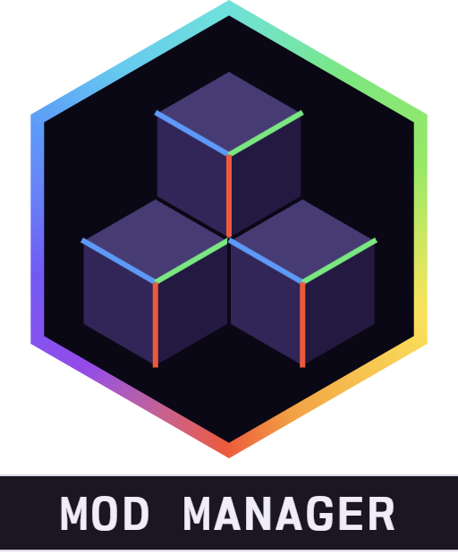
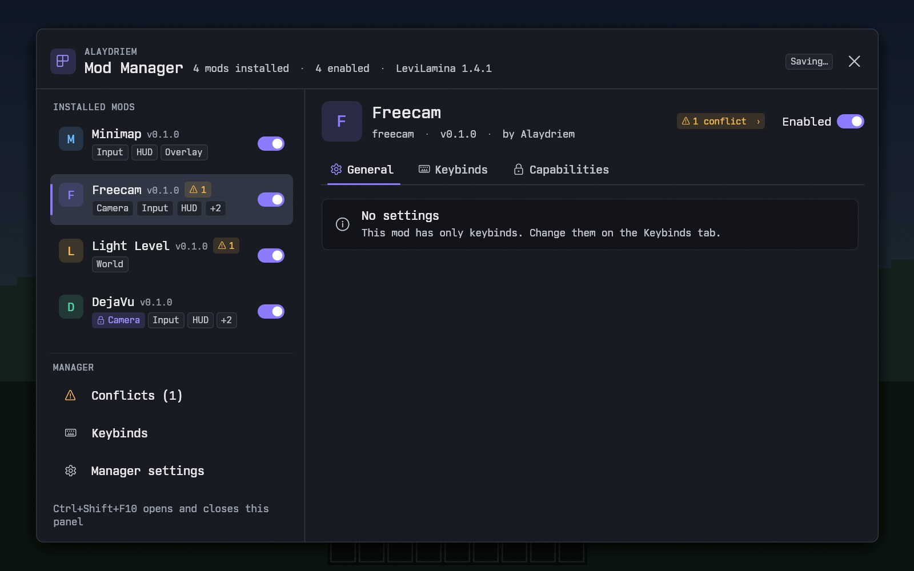
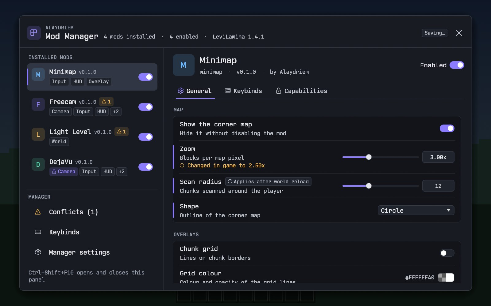
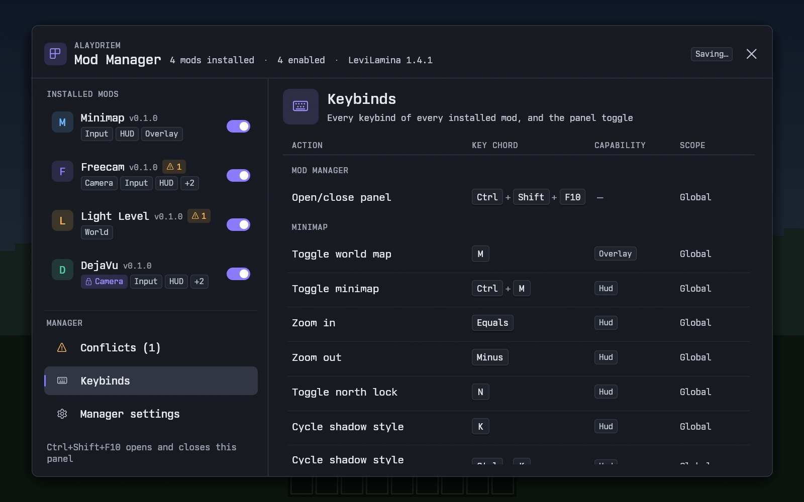
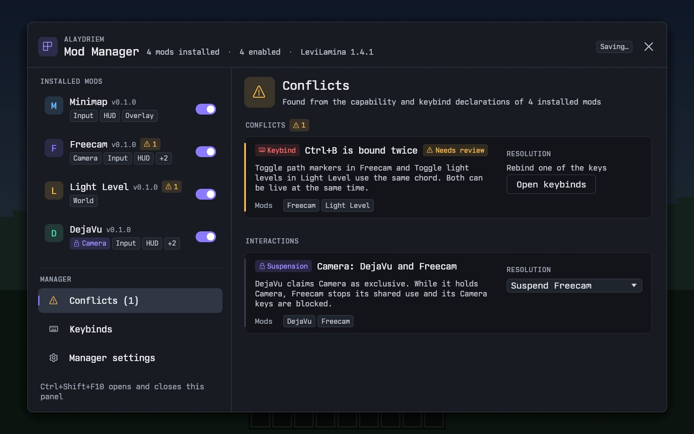

<div align="center">



# Alaydriem's Mod Manager

[](https://github.com/alaydriem/modmanager/releases)
[](https://github.com/alaydriem/modmanager/actions/workflows/build.yml)
[](./LICENSE)

[](https://github.com/alaydriem/amml)

</div>

A mod manager for [AMML](https://github.com/alaydriem/amml) client mods on Minecraft Bedrock (Windows) that providers a shared interface for setting keybinds, managing compatability, and enabling and disabling mods

<table>
  <tr>
    <td width="50%"></td>
    <td width="50%"></td>
  </tr>
  <tr>
    <td width="50%"></td>
    <td width="50%"></td>
  </tr>
</table>

## Installation

- Install [AMML](https://github.com/alaydriem/amml) first
- Install the DLL from the latest release to mods/amml/modmanager

| Manager | Minecraft Bedrock | AMML loader |
| --- | --- | --- |
| 26.60.0 | 1.26.51, 1.26.60 | 26.60.0 or later |

## Usage

Open the panel with <kbd>Ctrl</kbd> + <kbd>Shift</kbd> + <kbd>F10</kbd>, or the **Mods** button on the start and pause screens. The key can be changed on the Keybinds page.

Config lives in `mods/amml/@amml/modmanager/config/config.hcl`.

## For mod authors

Rust mods use the `amm-client` crate (`ManagerLink`) and describe their settings, keybinds and claims in a
`descriptor.hcl`. The C interface is in [`include/alaydriem_mod_manager.h`](./include/alaydriem_mod_manager.h).

A mod shows its own icon in the panel with `ManagerLink::set_icon_file` (a PNG, 1 to 256 px on each side). Without
one, the panel shows the first letter of the mod name.

## Building

Requires Windows x64, [mise](https://mise.jdx.dev), rustup and [cargo-nextest](https://nexte.st). The manager is a Rust AMML mod: `mise run build-mod` writes `dist/@amml/modmanager/` (the DLL, its PDB and `amml.hcl`). It builds against the AMML SDK from the `amml` git tag named in `Cargo.toml`; cargo fetches it.

```powershell
mise trust
mise run preflight
mise run build-mod
mise run test
```

## License

BSD 3-Clause. Copyright (c) 2026 Charles R. Portwood II. See [LICENSE](./LICENSE).
